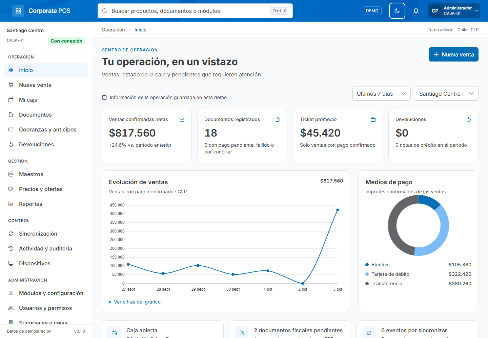

# POS Platform

Plataforma POS corporativa preparada para evolucionar a varios países: monorepo Nx con clientes web/escritorio, backend de sucursal, backend de país y workers. Incluye una demostración funcional de Chile con datos sintéticos y una base técnica NestJS/Fastify; las operaciones de negocio del backend y las integraciones están pendientes. Conserva el lenguaje visual de **prime-showcase** (PrimeNG, Aura corporativo, Inter, tablas y navegación).

Producto y repositorio: [POS Platform](https://github.com/floxcristian/pos-platform). Los aliases internos usan `@pos-platform/*`. La [guía del monorepo](docs/monorepo.md) explica aplicaciones, propietarios de datos, estructura por contexto y compatibilidad del cambio de nombre.

## Repositorio del producto

El frontend Angular con PrimeNG, el contenedor de escritorio, la base del backend y la documentación se mantienen juntos en este repositorio. `floxcristian/corporate-pos` conserva una versión anterior del frontend; el desarrollo vigente continúa en `floxcristian/pos-platform`.

| Ubicación | Responsabilidad y estado |
| --- | --- |
| `apps/pos-web` | Cliente Angular con PrimeNG y adaptadores mock |
| `apps/pos-desktop` | Contenedor Tauri del mismo cliente |
| `apps/pos-runtime` | Base HTTP NestJS/Fastify de sucursal |
| `apps/country-api` | Base HTTP de país |
| `apps/pos-sync-worker`, `apps/erp-worker` | Composición de workers; procesamiento de jobs pendiente |
| `apps/pos-docs` | Documentación técnica en Starlight |
| `libs/` | Features del frontend, contextos del backend y contratos compartidos, con límites de importación |

Las aplicaciones comparten repositorio y contratos, con builds independientes. El cliente conserva sus datos de demostración; la conexión con los casos de uso del backend se implementará a medida que existan esos contratos.



## Iniciar

Requiere Node.js 22.19 o posterior en la rama 22, o Node.js 24, y npm 11.6.0.

Si tu instalación usa otra versión de npm, instala las dependencias con `npx --yes npm@11.6.0 ci`.

```sh
git clone https://github.com/floxcristian/pos-platform.git
cd pos-platform
npm ci
npm start
```

Abre **http://127.0.0.1:4300**. La pantalla de acceso permite iniciar sesión con cuentas de demostración. Puedes completar el formulario desde **Accesos de demostración** o usar `admin@example.test` y la contraseña pública `Demo123!`. También están disponibles `supervisor@example.test`, `caja@example.test` y `auditor@example.test`, con la misma contraseña.

Hay una caja abierta con datos de ejemplo. El menú de usuario permite cambiar el perfil de demostración, simular desconexión, cambiar el tema y **Cerrar sesión**. La sesión se conserva en la pestaña; **Mantener sesión en este equipo** permite restaurarla al volver a abrir el navegador. Cerrar sesión elimina ese acceso, sin cerrar el turno ni borrar la venta en curso. Para comenzar de nuevo con los datos de ejemplo: **Módulos y configuración → Demostración → Restablecer**.

Todos los RUT, clientes, usuarios y operaciones son ejemplos sintéticos. No hay autenticación real, cargos bancarios, DTE válidos ni conexiones a sistemas corporativos. No ingreses información de producción.

## API de sucursal

```sh
npm run api:dev
```

La API escucha en **http://127.0.0.1:3000**. Expone información de la base en `/api/v1`, sondas en `/health/live` y `/health/ready`, y OpenAPI en `/api/docs` durante el desarrollo. Usa NestJS con Fastify como un proyecto Nx independiente: `apps/pos-runtime`.

La base sigue las convenciones verificadas de **Core**: composición de arranque separada, configuración tipada e inyectable, logging unificado con `nestjs-pino`, errores HTTP con contrato estable, versionado URI y pruebas Vitest/SWC. La [guía de la API](docs/api.md#referencia-core) identifica el commit de referencia y las decisiones adaptadas al backend de sucursal.

El reporte de errores con Sentry es opcional y está deshabilitado en los ejemplos, con DSN vacío. Cada aplicación tiene un cliente privado que captura fallos en fronteras explícitas y admite solo metadatos técnicos y frames reducidos; no envía datos de clientes, cuerpos de operaciones ni logs completos. Consulta el [alcance de captura y configuración](docs/api.md#reporte-opcional-de-errores-con-sentry). No se ha conectado un proyecto real de Sentry.

Los puntos de entrada `country-api`, `pos-sync-worker` y `erp-worker` preparan los procesos de país, sincronización y ERP. Comparten la base técnica de `libs/platform/backend`; los contextos de `libs/backend` delimitan dónde implementar las capacidades. Rspack/SWC empaqueta las aplicaciones Node y sus librerías fuente; TSC verifica tipos. Crear estas fronteras no conecta bases, colas ni proveedores.

```sh
npm run api:check
npm run api:build
npm run api:smoke
```

Para comprobar el scaffold completo: `npm run backend:check`, `npm run backend:smoke` y `npm run structure:check`. `npm run country:dev` inicia la API de país en el puerto 3001; `npm run sync:check` y `npm run erp:check` verifican la composición y cierre de los workers sin ejecutar jobs. Consulta todos los [comandos del workspace](docs/monorepo.md#comandos-del-workspace).

El backend y las librerías puras tienen lint con información de tipos para detectar promesas sin manejar y usos inseguros, además de fronteras Nx verificadas. Las [reglas y su alcance](docs/monorepo.md#reglas-de-código-y-fronteras) distinguen esos controles de los del frontend; no sustituyen pruebas de comportamiento ni los requisitos pendientes de producción.

El frontend sigue usando sus adaptadores mock. Esta base de API aún no implementa autenticación, base de datos, operaciones de negocio ni sincronizadores; la sonda de readiness comprueba únicamente la aplicación. Consulta [configuración, contratos y despliegue de la API](docs/api.md).

## Publicar el frontend y la documentación en Vercel

El repositorio incluye `vercel.json` para compilar el frontend estático y la guía Starlight. Importa `floxcristian/pos-platform` en Vercel con **Root Directory en la raíz del repositorio**, Framework Preset **Other** y Node.js **24.x**. Los comandos y la carpeta de salida se leen del archivo. Publica el POS en `/` y la documentación en `/guide/`; las aplicaciones del backend tienen sus propios artefactos y despliegues. No requiere variables de entorno para la demostración.

Consulta la [guía de despliegue](docs/vercel.md) con los valores exactos y los pasos de comprobación. El instalador de Windows se genera por separado con Tauri.

## Recorridos

| Área              | Qué puedes probar                                                                                                                                                                              |
| ----------------- | ---------------------------------------------------------------------------------------------------------------------------------------------------------------------------------------------- |
| Inicio            | Indicadores por período y sucursal, gráficos, ranking y pendientes derivados de las operaciones                                                                                                |
| Venta             | Productos y códigos de barra, cantidades, descuentos y ofertas, cliente express, boleta/factura, despacho, pagos mixtos, vuelto y ventas pausadas; órdenes de venta con condiciones protegidas |
| Pagos             | Efectivo, débito/crédito, transferencia, cheques con Orsan, crédito cliente, NC y USD; escenario de pago incierto con conciliación sin volver a cobrar                                         |
| Mi caja           | Apertura, ingresos/egresos, custodia, conteo por denominación, arqueo, diferencias con motivo, cierre, cambio de cajero y confirmación de depósitos de custodia                                |
| Documentos        | Búsqueda y filtros, detalle, estados local/pago/fiscal/ERP separados, emisión simulada y representación imprimible                                                                             |
| Cobranzas         | Saldos y documentos pendientes, convenios en cuotas, cobro y anticipos aplicables a ventas sin cobrar de nuevo                                                                                 |
| Devoluciones      | Nota de crédito por cantidades, emisión fiscal simulada y devolución de dinero como acciones distintas                                                                                         |
| Maestros          | Productos, clientes, bancos, plazas, motivos de NC y vendedores; edición validada y exportación                                                                                                |
| Precios y ofertas | Cambio de precio, condiciones por cliente/volumen, descuentos por producto y vigencia, habilitación y auditoría                                                                                |
| Reportes          | Ventas, pagos, caja, cobranzas, devoluciones y pendientes fiscal/ERP; filtros y CSV                                                                                                            |
| Sincronización    | Flujos de subida/bajada, ejecución manual, horarios e intervalos por día, errores simulados, reintentos, cola de salida e historial                                                            |
| Control           | Logs con correlación, auditoría por actor/acción y diagnóstico descargable                                                                                                                     |
| Administración    | Módulos y políticas, usuarios/permisos, sucursales/cajas, dispositivos e integraciones, recorrido de actualización mock                                                                        |

El inventario consultivo no cambia al vender: la caja de Chile no es la autoridad de stock. Los temporizadores de sincronización funcionan mientras la aplicación está abierta; no son un servicio de Windows.

## Arquitectura

```text
apps/
  pos-web/          Interfaz Angular con adaptadores mock
  pos-desktop/      Contenedor Tauri 2 para Windows
  pos-runtime/      Backend HTTP de sucursal
  pos-sync-worker/  Sincronización de sucursal
  country-api/      Backend HTTP de país
  erp-worker/       Integración ERP
  pos-docs/         Documentación Starlight
libs/
  backend/          Contextos: sales, cash, payments, collections, returns,
                    pricing, catalog, fiscal, devices, sync, erp,
                    reporting y administration
  contracts/        Contratos entre aplicaciones
  shared-kernel/    Primitivas puras del producto
  country-policies/ Perfiles y políticas nacionales
  platform/backend/ Base técnica compartida por las aplicaciones Node
  domain/           Reglas puras del prototipo frontend actual
  data-access/      Estado y adaptadores mock del frontend
  ui/               Preset y componentes de presentación
  features/         Access, checkout, insights y administration de la UI
```

La [guía del monorepo](docs/monorepo.md) distingue base implementada, scaffold y trabajo pendiente. Las librerías backend no importan Angular ni los adaptadores mock; los contextos se implementan progresivamente con sus propios contratos y datos.

Las features consumen `PosStore`; no escriben en `localStorage`. Los permisos y módulos se validan en rutas **y comandos**. El estado se publica como snapshots inmutables. Las transacciones guardan primero el snapshot y publican el resultado solo si la persistencia tuvo éxito. Las ventas y eventos conservan identificadores para evitar duplicados. Pago, fiscalidad y ERP tienen ciclos separados.

La identidad de acceso se guarda por ID de usuario en `corporate-pos:auth:v1`, separada de los datos de negocio y del turno de caja. Usa `sessionStorage` o `localStorage` según la opción de permanencia; nunca guarda la contraseña. Las rutas protegidas redirigen al login y la autorización consulta el rol del usuario activo. Son controles de demostración locales: el adaptador debe sustituirse por autenticación y autorización corporativas para producción.

Los límites de importación se verifican con Nx/ESLint. Se usan Angular con detección de cambios OnPush y signals, TypeScript estricto, carga diferida por área y componentes PrimeNG. La tipografía y los iconos se sirven localmente. No se utilizan `patch-package`, dependencias privadas de fuentes, telemetría ni servicios del proyecto de referencia.

## Validación

```sh
npm run lint
npm test
npm run build
npx playwright install chromium
npm run test:e2e
npm run desktop:info
```

Las pruebas cubren políticas, montos, persistencia, permisos, reintentos, calendarios y recorridos de navegador. CI está configurada para compilar y empaquetar la demostración para Windows; las nuevas ejecuciones publican el artefacto `pos-platform-windows-demo` durante siete días. Las acciones de CI están fijadas por commit y tienen permisos de lectura.

Validación tras la revisión de calidad (3 de octubre de 2026): **144 pruebas de lógica e infraestructura y 37 recorridos de navegador pasan**, junto con lint, formato y compilación web de producción. Los recorridos ejecutan el bundle productivo con la CSP de Tauri, incluyen tamaños de 375 y 1440 px y verifican controles de prime-showcase y accesibilidad del dashboard/reportes en claro y oscuro. El [informe de revisión](docs/quality-review.md) detalla correcciones y condiciones pendientes para producción.

La [ejecución histórica de CI](https://github.com/floxcristian/corporate-pos/actions/runs/37151843645), del repositorio anterior, completó las validaciones de esa revisión. Las comprobaciones actuales se consultan en [Actions de pos-platform](https://github.com/floxcristian/pos-platform/actions). El instalador se puede regenerar con `npm run desktop:build`.

## Escritorio

```sh
npm run desktop:dev
npm run desktop:build
```

Necesita Rust, MSVC/Windows SDK y WebView2. Consulta [preparación de Tauri](docs/desktop.md). El contenedor no tiene comandos para cobrar, imprimir físicamente o acceder libremente al sistema. El instalador de CI es una demostración sin firma comercial.

## De maqueta a producto

Esta entrega permite validar la UX y las reglas mock; **no es una caja certificada ni lista para operar en producción**. El adaptador local del navegador y la base HTTP no sustituyen la persistencia transaccional de sucursal, autenticación corporativa, permisos verificados por servidor, conciliación bancaria ni homologación fiscal. Esas fronteras y el diseño para evolucionarlas se describen en [arquitectura](docs/architecture.md), [seguridad](docs/security.md), [base de API](docs/api.md) y [contratos mock](docs/mock-api.md).

La cobertura de Chile y las referencias revisadas están en [inventario de la caja actual](docs/audit-chile-for-product.md). Ese inventario distingue la funcionalidad de referencia, la simulación y lo que necesita integración real.

## Documentación técnica

La guía Starlight pertenece a este monorepo: aplicación `apps/pos-docs`, fuentes en `docs/`, catálogo y diagramas versionados junto al producto. [Mantenimiento y publicación](apps/pos-docs/README.md).

```sh
npm run docs:install
npm run docs:dev
```

`npm run docs:build` produce una salida estática independiente en `dist/apps/pos-docs`. `npm run build:vercel` ensambla la web y `/guide/` para el mismo despliegue. El repositorio de presentaciones consume un snapshot derivado fijado por commit; no mantiene otra fuente editable de la guía.
