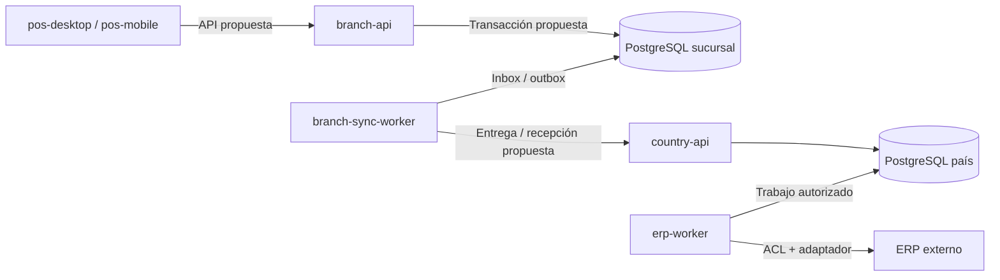

# Monorepo POS Platform

> **Alcance del código:** este monorepo reúne los clientes Angular/PrimeNG para escritorio (Tauri) y móvil (Capacitor), la base NestJS/Fastify y la documentación Starlight. La interfaz mantiene adaptadores mock; la base backend aporta configuración, observabilidad, sondas y puntos de composición. Los módulos comerciales y workers todavía no ejecutan operaciones reales.

POS Platform es la base de un producto corporativo para varios países. El monorepo reúne clientes de escritorio y móvil, backend de sucursal, backend de país y workers con ciclos de ejecución propios. La demostración funcional actual cubre Chile; la estructura multipaís permite organizar la evolución sin afirmar que las reglas fiscales o integraciones de otros países estén implementadas.

`apps/pos-desktop` y `apps/pos-mobile` tienen arranques Angular independientes y comparten `libs/client-shell`; sus pantallas, estado mock y componentes viven en `libs/features`, `libs/data-access`, `libs/domain` y `libs/ui`. El shell define `createClientConfig(platform)`, rutas, guards y navegación. `libs/ui/assets` y `libs/ui/src/styles.css` se consumen desde ambos builds. La [decisión de clientes nativos](decisions/native-clients.md) elimina `pos-web` y separa los artefactos Tauri y Capacitor. La API de sucursal está en `apps/branch-api`; comparte infraestructura técnica con las otras aplicaciones backend mediante `libs/platform/backend`. Todos se revisan y versionan en [pos-platform](https://github.com/floxcristian/pos-platform), con builds separados. Compartir repositorio no significa compartir proceso ni persistencia: el frontend aún no consume las operaciones de esta API, que tampoco están implementadas.

## Nombres de las aplicaciones backend

Las aplicaciones se nombran por ámbito o responsabilidad y tipo de proceso: `branch-api`, `branch-sync-worker`, `country-api` y `erp-worker`. `branch` identifica la sucursal y `country` el ámbito de país; `api` identifica la entrada HTTP y `worker` un proceso de trabajo separado. Los contextos DDD (`sales`, `cash`, `payments`, etc.) conservan sus nombres y límites dentro de las bibliotecas: una aplicación puede componer varios contextos sin convertirlos en microservicios.

El cambio de nombres del 21 de octubre de 2026 **ya está aplicado físicamente**: `pos-runtime` pasa a `branch-api` y `pos-sync-worker` a `branch-sync-worker`. Cambian las carpetas, proyectos Nx, paquetes, artefactos e identidades de servicio. Los comandos públicos `api:*` y `sync:check` se conservan. Los prefijos de entorno pasan de `POS_API_*` a `BRANCH_API_*` y de `POS_SYNC_WORKER_*` a `BRANCH_SYNC_WORKER_*`; los prefijos anteriores no son aliases. La [guía de API](api.md#actualización-de-nombres-y-configuración) describe el ajuste de configuraciones y consumidores.

El término técnico `runtime` se mantiene cuando significa entorno o configuración de ejecución, por ejemplo `RuntimeConfigService`; ya no identifica la aplicación de sucursal. Este cambio es independiente del traslado pendiente de bibliotecas a `shared` y de las suites E2E.

## Estructura objetivo acordada

**Decisión del 21 de octubre de 2026:** agrupar el código transversal en `libs/shared/`, manteniendo los contextos de negocio en `libs/backend/`. Core se utiliza exclusivamente como referencia de organización y convenciones; el POS es independiente y no consumirá su código, paquetes ni servicios.

Este árbol describe el **destino de la organización**. Los clientes desktop/mobile ya figuran en el código; shared y el proyecto E2E siguen pendientes. Se mantienen seis aplicaciones operativas y una documental. `pos-clients-e2e` será un proyecto de pruebas, sin proceso de negocio ni artefacto de despliegue.

<!-- monorepo:target:start -->
```text
apps/
  pos-desktop/                  # [conservado] Cliente Angular con arranque propio y host Tauri
  pos-mobile/                   # [conservado] Cliente Angular con arranque propio y host Capacitor
  branch-api/                   # [conservado] API y composición de negocio de sucursal
  branch-sync-worker/           # [conservado] Proceso de entrega y recepción de sucursal
  country-api/                  # [conservado] API de recepción y capacidades de país
  erp-worker/                   # [conservado] Proceso de integración, traducción y conciliación ERP
  pos-clients-e2e/              # [mover] Pruebas de la UI; proyecto Nx de pruebas, sin despliegue
    mobile/                     # [mover] Suite Angular móvil; no prueba el host Capacitor
  pos-docs/                     # [conservado] Documentación Starlight; fuera del runtime POS
libs/
  backend/
    sales/                      # [conservado] Ventas y documentos comerciales; scaffold comercial
    cash/                       # [conservado] Turnos y movimientos de caja; scaffold comercial
    payments/                   # [conservado] Intentos, resultados y conciliación de pagos; scaffold comercial
    collections/                # [conservado] Cobranzas y anticipos; scaffold comercial
    returns/                    # [conservado] Devoluciones y referencias al documento original; scaffold comercial
    pricing/                    # [conservado] Evaluación y versiones de precios y promociones; scaffold comercial
    catalog/                    # [conservado] Maestros y proyecciones de consulta; scaffold comercial
    fiscal/                     # [conservado] Documentos y estados fiscales por país/proveedor; scaffold comercial
    devices/                    # [conservado] Contratos y coordinación de periféricos; scaffold comercial
    sync/                       # [conservado] Protocolo y progreso de sincronización; scaffold comercial
    erp/                        # [conservado] Contratos, ACL y adaptadores ERP; scaffold comercial
    reporting/                  # [conservado] Consultas y proyecciones de reportes; scaffold comercial
    administration/             # [conservado] Configuración y ámbito organizacional; scaffold comercial
  client-shell/                 # [conservado] Composición Angular compartida; no es una aplicación desplegable
  features/                     # [conservado] Funcionalidades de la interfaz
  shared/
    backend/                    # [mover] Base técnica del servidor; división de proyectos por definir
      bootstrap/                # [mover] Creación, arranque y cierre
      config/                   # [mover] Configuración validada e inyectable
      http/                     # [mover] Adaptación HTTP, errores y contrato técnico
      observability/            # [mover] Pino, correlación y Sentry opcional
      health/                   # [mover] Sondas del proceso y disponibilidad comprobada
      worker/                   # [mover] Ciclo de vida de procesos de trabajo
    frontend/
      ui/                       # [mover] Preset, tokens y componentes de presentación
    kernel/                     # [mover] Modelo mínimo acordado entre contextos; sin frameworks
    contracts/                  # [mover] Sobres y metadatos técnicos comunes; no todos los DTO de negocio
    testing/                    # [por incorporar] Soporte técnico extraído cuando existan consumidores comunes
  country-policies/             # [transitorio] Perfiles puros actuales; reglas específicas bajo su contexto
  domain/                       # [transitorio] Reglas del prototipo; revisar propiedad antes de migrar
  data-access/                  # [transitorio] Adaptadores mock; revisar por funcionalidad, sin mover en bloque a shared
tools/                          # [conservado] Herramientas de build, lint, pruebas y diagramas
docs/                           # [conservado] Fuentes canónicas de Starlight
.github/
  workflows/                    # [conservado] Validaciones y entrega
```
<!-- monorepo:target:end -->

Las etiquetas distinguen lo conservado, lo que debe moverse, lo transitorio y el soporte por incorporar. Las carpetas internas de `shared/backend` representan responsabilidades; no prescriben una biblioteca Nx por carpeta ni cambian todavía los proyectos del código.

### Correspondencia con el checkout actual

<!-- monorepo:migration:start -->
| Ruta física actual | Destino acordado | Estado |
| --- | --- | --- |
| `e2e` | `apps/pos-clients-e2e` | mover |
| `e2e-mobile` | `apps/pos-clients-e2e/mobile` | mover |
| `libs/platform/backend` | `libs/shared/backend` | mover |
| `libs/platform/backend/src/bootstrap` | `libs/shared/backend/bootstrap` | mover |
| `libs/platform/backend/src/config` | `libs/shared/backend/config` | mover |
| `libs/platform/backend/src/common/http` | `libs/shared/backend/http` | mover |
| `libs/platform/backend/src/common/observability` | `libs/shared/backend/observability` | mover |
| `libs/platform/backend/src/health` | `libs/shared/backend/health` | mover |
| `libs/platform/backend/src/worker` | `libs/shared/backend/worker` | mover |
| `libs/ui` | `libs/shared/frontend/ui` | mover |
| `libs/shared-kernel` | `libs/shared/kernel` | mover |
| `libs/contracts` | `libs/shared/contracts` | mover |
| `sin biblioteca dedicada` | `libs/shared/testing` | por incorporar |
| `libs/country-policies` | `libs/country-policies` | transitorio |
| `libs/domain` | `libs/domain` | transitorio |
| `libs/data-access` | `libs/data-access` | transitorio |
<!-- monorepo:migration:end -->

La migración deberá trasladar cada responsabilidad, sus tests y referencias. No se mantendrán `platform/backend` y `shared/backend` como dos alternativas permanentes. Los aliases actuales `@pos-platform/backend`, `@pos-platform/contracts`, `@pos-platform/shared-kernel` y `@pos-platform/ui` siguen siendo válidos hasta una migración comprobada; esta decisión documental no anuncia imports nuevos disponibles.

`libs/country-policies` conserva por ahora perfiles y selección explícita de políticas. Las reglas fiscales, comerciales o de pagos pertenecen a su contexto; no se trasladarán indiscriminadamente al kernel. `domain` y `data-access` se revisarán por responsabilidad durante la sustitución del prototipo: su uso por varias pantallas no los convierte completos en infraestructura compartida.

### Inventario físico actual

Este inventario mantiene las rutas ejecutables que debe usar un desarrollador antes de la migración.

<!-- monorepo:current:start -->
```text
apps/
  pos-desktop/            # Cliente Angular con arranque propio y host Tauri
  pos-mobile/             # Cliente Angular con arranque propio y host Capacitor
  branch-api/             # API y composición de negocio de sucursal
  branch-sync-worker/     # Proceso de entrega y recepción de sucursal
  country-api/            # API de recepción y capacidades de país
  erp-worker/             # Proceso de integración, traducción y conciliación ERP
  pos-docs/               # Documentación estática; fuera del runtime POS
libs/
  backend/sales/          # Ventas y documentos comerciales
  backend/cash/           # Turnos y movimientos de caja
  backend/payments/       # Intentos, resultados y conciliación de pagos
  backend/collections/    # Cobranzas y anticipos
  backend/returns/        # Devoluciones y referencias al documento original
  backend/pricing/        # Evaluación y versiones de precios y promociones
  backend/catalog/        # Maestros y proyecciones de consulta
  backend/fiscal/         # Documentos y estados fiscales por país/proveedor
  backend/devices/        # Contratos y coordinación de periféricos
  backend/sync/           # Protocolo y progreso de sincronización
  backend/erp/            # Contratos, ACL y adaptadores ERP
  backend/reporting/      # Consultas y proyecciones de reportes
  backend/administration/ # Configuración y ámbito organizacional
  contracts/              # Contratos versionados entre aplicaciones
  shared-kernel/          # Primitivas puras comunes: identidad, dinero y moneda
  country-policies/       # Perfiles y contratos de políticas nacionales
  platform/backend/       # Arranque, configuración, HTTP, logging y errores
  domain/                 # Reglas puras del prototipo frontend existente
  data-access/            # Estado y adaptadores mock del frontend
  client-shell/           # Composición Angular compartida, configuración por plataforma, rutas y shell
  ui/                     # Componentes, tokens, estilos y activos visuales compartidos
  features/               # Pantallas de acceso, caja, análisis y administración
e2e/                      # Playwright del cliente de escritorio en navegador
e2e-mobile/               # Playwright del cliente móvil en navegador
tools/                    # Build, pruebas de arquitectura, verificación de artefactos y diagramas
docs/                     # Fuentes documentales
.github/workflows/        # CI del producto y de la documentación
```
<!-- monorepo:current:end -->

Las librerías actuales se consumen por su entrada pública `@pos-platform/<nombre>`; las pantallas usan `@pos-platform/features/<nombre>`. El grafo Nx y las reglas de importación expresan sus fronteras. Una carpeta no equivale a un servicio desplegado.

## Composición de los clientes

`pos-desktop` y `pos-mobile` tienen arranques y builds Angular propios. Tauri aloja el cliente de escritorio; Capacitor aloja el móvil. La ejecución nativa y homologación no se deducen de un build Angular.

`libs/client-shell` comparte composición de rutas, configuración y shell entre clientes; `libs/features` mantiene las funcionalidades. El shell compone features y permanece como biblioteca de composición, fuera de la infraestructura genérica de `shared/frontend`. Compartir código entre apps no convierte todas sus responsabilidades en utilidades transversales.

La UI reutilizable vive actualmente en `libs/ui` y se moverá a `shared/frontend/ui`. Los contratos puros pueden ser consumidos por ambos clientes; las implementaciones Nest, SQL y SDK de servidor permanecen fuera de sus dependencias.

## Límites DDD de shared

`shared/` agrupa bibliotecas con responsabilidades independientes. No será una biblioteca universal ni tendrá un barrel `@pos-platform/shared` que exporte todo. Cada biblioteca tendrá una entrada pública y dependencias verificables; un proyecto Nx adicional se justifica por su responsabilidad, consumidores o aislamiento, no por el número de carpetas.

| Grupo objetivo | Contenido permitido | Propietario y límite |
| --- | --- | --- |
| `shared/backend` | Arranque, configuración, HTTP, observabilidad y mecanismos técnicos | No conoce reglas comerciales ni importa implementaciones de los contextos |
| `shared/frontend/ui` | Tokens, preset y componentes de presentación | No accede a persistencia ni decide descuentos, permisos comerciales o pagos |
| `shared/kernel` | Conceptos mínimos con semántica e invariantes acordadas entre contextos | TypeScript puro; cambios coordinados con sus consumidores; no un modelo global de entidades |
| `shared/contracts` | Sobres de mensajes y metadatos transversales de intercambio | Sin Nest, Angular ni modelos ORM; no absorbe todos los contratos de negocio |
| `shared/testing` | Relojes controlables, fixtures técnicas y soporte reutilizable | Solo consumidores de pruebas; producción no puede importarlo |

Un contrato como `SaleConfirmedV1` pertenece a ventas y se expone desde una entrada pública de contratos del contexto, independiente de Nest y de sus entidades internas. El sobre técnico puede pertenecer a `shared/contracts`. Compartir un contrato no transfiere la propiedad del negocio al grupo compartido.

Un tipo `Money` solo pertenece al kernel si sus consumidores acuerdan la misma semántica. Los tipos iniciales actuales no implementan por sí solos validación de importes, redondeo o políticas comerciales. `Customer`, `Product` y `Sale` no se centralizan porque compartan nombres o campos: cada contexto conserva el modelo que necesita.

### Direcciones de dependencia objetivo

- Las apps componen módulos; los controladores delegan casos de uso.
- El dominio de cada contexto depende únicamente de código puro y, cuando proceda, del kernel acordado. No importa infraestructura técnica, Nest, Angular ni ORM.
- Aplicación define los puertos; infraestructura los implementa con mecanismos de `shared/backend`. La composición conecta esas piezas.
- Los contextos colaboran mediante contratos públicos y puertos explícitos; no importan repositorios, tablas ni implementaciones privadas ajenas.
- El frontend consume contratos públicos y presentación; no importa bibliotecas de servidor.
- Las bibliotecas de producción no importan `shared/testing` ni proyectos E2E. Las pruebas pueden consumir sus APIs públicas.

Las reglas Nx actuales separan navegador, servidor y librerías puras, pero todavía no implementan toda esta clasificación objetivo. La migración debe actualizar tags, restricciones y pruebas negativas, incluidas importaciones internas dentro de un proyecto cuando Nx no pueda separarlas. La estructura documental no se presenta como enforcement ya instalado.

### Infraestructura pendiente y propiedad de datos

Autenticación/autorización, persistencia, migraciones, mensajería durable, idempotencia y resiliencia requieren implementación. No se crean módulos vacíos para dar por resueltas esas capacidades. Caché, alertas y controles operativos se incorporan con un consumidor, contrato y criterio de aceptación concretos.

La conexión y el ejecutor técnico de transacciones pueden compartirse; las tablas, repositorios y migraciones de ventas siguen perteneciendo a ventas. La escritura comercial y su outbox deben compartir la transacción correspondiente. Una utilidad de reintentos no decide repetir un pago de resultado desconocido: esa política pertenece a pagos.

## Proyectos de pruebas y herramientas

Las suites actuales en `e2e/` y `e2e-mobile/` usan Playwright y recorren las interfaces Angular con adaptadores mock. Su destino acordado es `apps/pos-clients-e2e/`, con proyecto Nx, target E2E y dependencias explícitas de `pos-desktop` y `pos-mobile`. No cuenta como aplicación operativa. La migración debe conservar fixtures, reportes, arranque local y ejecución contra el build de producción en CI.

Las pruebas HTTP permanecen junto a cada API; las pruebas unitarias y de integración se mantienen cerca de su código. `shared/testing` solo extrae soporte técnico compartido: las fábricas de ventas o pagos conservan su propietario. `tools/backend` sigue siendo herramienta del workspace, no una dependencia de runtime.

Una suite `pos-system-e2e` requerirá un recorrido real sucursal–persistencia–país. `pos-desktop-e2e` se justificará con capacidades nativas de Tauri: probar Angular en Chromium no verifica instalación ni periféricos. Esas suites son futuras y no forman parte del inventario existente. La [guía de pruebas](testing.md) detalla alcances y criterios.

## Aplicaciones y ubicación propuesta

<!-- monorepo:applications:start -->
| Aplicación | Lugar previsto | Responsabilidad | Estado revisado |
| --- | --- | --- | --- |
| `pos-desktop` | Puesto Windows | Cliente Angular con arranque propio y host Tauri | Cliente con adaptadores mock; integración nativa real pendiente |
| `pos-mobile` | Dispositivo Android/iOS | Cliente Angular con arranque propio y host Capacitor | Base móvil con adaptadores mock; ejecución y distribución nativas por verificar |
| `branch-api` | Sucursal | API y composición de negocio de sucursal | Base HTTP local; sin persistencia ni operaciones comerciales |
| `branch-sync-worker` | Sucursal | Proceso de entrega y recepción de sucursal | Esqueleto local; sin jobs ni sincronización real |
| `country-api` | País | API de recepción y capacidades de país | Base HTTP local; sin recepción de ventas ni consolidación |
| `erp-worker` | Red autorizada del ERP | Proceso de integración, traducción y conciliación ERP | Esqueleto local; sin conexión a ERP |
| `pos-docs` | Sitio documental estático | Guía Starlight de arquitectura, implementación y evidencia | Aplicación documental; no participa en la operación de caja |
<!-- monorepo:applications:end -->

Los workers tienen ciclo de vida propio. No se añade un listener HTTP de negocio solo para ejecutar tareas. Un futuro backoffice separado o un worker adicional de país requiere una necesidad concreta; no forma parte de estas seis aplicaciones operativas. `pos-docs` es una séptima aplicación, documental: no ejecuta procesos del POS ni importa sus librerías de negocio.

## Comandos del workspace

| Comando                   | Alcance                                                                          |
| ------------------------- | -------------------------------------------------------------------------------- |
| `npm start` | Interfaz Angular de escritorio en `http://127.0.0.1:4300` |
| `npm run build` | Compila los bundles Angular de escritorio y móvil secuencialmente |
| `npm run desktop:bundle` | Compila sólo el bundle Angular de escritorio |
| `npm run desktop:dev` | Abre Tauri con servidor de desarrollo |
| `npm run desktop:build` | Empaqueta Tauri, incluido su bundle Angular |
| `npm run mobile:start` | Interfaz Angular móvil en `http://127.0.0.1:4301` |
| `npm run mobile:build` | Compila sólo el bundle Angular móvil |
| `npm run mobile:sync:android` / `mobile:sync:ios` | Construye y sincroniza el proyecto nativo |
| `npm run mobile:android` / `mobile:ios` | Ejecuta el cliente en el entorno nativo disponible |
| `npm run docs:dev`        | Guía Starlight; instalar primero sus dependencias con `npm run docs:install`     |
| `npm run api:dev`         | API de sucursal en `http://127.0.0.1:3000`                                       |
| `npm run country:dev`     | API de país en `http://127.0.0.1:3001`                                           |
| `npm run sync:check`      | Compone y cierra el contexto del worker de sincronización; no ejecuta jobs       |
| `npm run erp:check`       | Compone y cierra el contexto del worker ERP; no envía operaciones                |
| `npm run backend:check`   | Lint, tipos, pruebas y build de proyectos backend y librerías puras del producto |
| `npm run backend:build`   | Genera los artefactos de las cuatro aplicaciones backend                         |
| `npm run backend:smoke`   | Verifica los cuatro artefactos fuera del monorepo con dependencias de producción |
| `npm run structure:check` | Comprueba las reglas arquitectónicas del scaffold                                |
| `npm run graph`           | Muestra el grafo de proyectos Nx                                                 |

Los comandos `api:*` se conservan para trabajar únicamente con `branch-api`. Los checks de workers comprueban composición y cierre; no equivalen a tener un consumidor, calendario o cola funcionando.

## Propiedad de datos por contexto

Esta tabla fija la responsabilidad propuesta para implementar los módulos. No describe tablas o repositorios ya creados. La misma librería puede aportar contratos y casos de uso a más de una aplicación, pero una operación conserva una autoridad de escritura definida.

| Contexto         | Datos y decisiones bajo su responsabilidad                                                     | Frontera que debe conservar                                                                                |
| ---------------- | ---------------------------------------------------------------------------------------------- | ---------------------------------------------------------------------------------------------------------- |
| `sales`          | Venta, líneas, importes y referencias comerciales; versión de precios aplicada                 | El escritor de sucursal confirma la operación; la copia de país no reescribe su historia                   |
| `cash`           | Turno, fondo, movimientos, arqueo, custodia y cierre                                           | Solo el módulo modifica el libro de caja; pagos y ventas aportan hechos mediante contratos                 |
| `payments`       | Intento de pago, referencia externa, resultado confirmado/rechazado/desconocido y conciliación | Un timeout no autoriza un segundo cobro; la evidencia bancaria sigue perteneciendo al proveedor            |
| `collections`    | Aplicaciones de cobros y anticipos, referencias a deuda y reservas autorizadas                 | Leer un saldo no concede exclusividad para consumirlo; se debe acordar la autoridad de reserva             |
| `returns`        | Cantidades devueltas y vínculo con las líneas e importes originales                            | Devolución comercial, documento fiscal y devolución de dinero son operaciones diferentes                   |
| `pricing`        | Espejo versionado, vigencias, reglas, conjunto activo y resultado explicable                   | La sucursal evalúa datos autorizados; no pasa a ser autora del precio corporativo                          |
| `catalog`        | Proyecciones de productos, clientes y maestros necesarios para operar                          | Cada dato conserva su dueño; el stock consultivo de Chile no se modifica al vender                         |
| `fiscal`         | Solicitudes de emisión, referencias y estados del proveedor fiscal                             | El estado local y la impresión no acreditan aceptación fiscal; homologación por país                       |
| `devices`        | Configuración y estado de comandos de periféricos a través de puertos                          | SDK, drivers y capacidades nativas quedan en adaptadores; entregar al spooler no prueba impresión física   |
| `sync`           | Inbox/outbox, cursor, intento, entrega, programación y acuses                                  | Los productores insertan outbox en la transacción de negocio; el worker no escribe tablas ajenas           |
| `erp`            | Traducciones, referencias externas, entrega y resultado del ERP                                | DTO y estados externos quedan detrás de ACL/adaptadores; un acuse de transporte no equivale a registro ERP |
| `reporting`      | Proyecciones y consultas para indicadores, reportes y exportaciones                            | No modifica operaciones de origen; distingue información incompleta o pendiente                            |
| `administration` | Ámbito empresa/país/sucursal/caja, módulos, políticas y asignaciones                           | Identidad y autorización necesitan integración real; configuración no reemplaza controles de servidor      |

PostgreSQL de sucursal es la persistencia recomendada para negocio y mensajes durables del perfil sin WAN. PostgreSQL operativo por país mantiene sus propias recepciones y proyecciones. Los clientes no acceden a SQL directamente. Esos motores y migraciones están pendientes; no se instala una base por caja como consecuencia de crear el monorepo.



El diagrama muestra la topología objetivo. En esta entrega no existen las conexiones entre aplicaciones, bases y proveedores. El frontend sigue usando el mock. La continuidad ante caída de WAN depende de la LAN y del servidor de sucursal; autonomía ante caída de ambos sería un perfil adicional con decisiones propias.

## Capas y reutilización interna

Los contextos se crean como un esqueleto explícito para dar ubicación y propietario al trabajo. Sus módulos y contratos iniciales no constituyen una implementación de negocio. No se añaden fachadas que devuelvan éxitos ficticios, repositorios vacíos presentados como persistencia ni endpoints de mutación sin casos de uso.

Cuando se implemente una capacidad, la organización interna sigue su complejidad:

- `api`: controladores, DTO y validación del contrato de entrada.
- `application`: casos de uso, coordinación y puertos requeridos.
- `domain`: reglas e invariantes puras cuando exista dominio que lo justifique.
- `infrastructure`: adaptadores de datos, proveedores o dispositivos.
- `config`: composición y configuración específica del contexto.

Un módulo de consulta simple no necesita fabricar entidades o cinco proyectos Nx separados. Los contextos se comunican por fachadas o interfaces públicas cuando esa interacción exista; no importan repositorios ni modelos privados de otro contexto. `shared-kernel` contiene únicamente conceptos estables compartidos; `contracts` describe intercambios versionados, y `country-policies` concentra variaciones nacionales explícitas. Ninguna de esas tres librerías puras depende de Nest o Angular.

En las rutas físicas actuales, la reutilización técnica entre apps del propio POS sí existe: las aplicaciones Node comparten configuración, HTTP, errores, logging y ciclo de vida mediante `platform/backend`. La app compone sus módulos y selecciona su identidad; la plataforma no conoce reglas comerciales de los contextos.

El logging permanece en Pino mediante `nestjs-pino`. El reporte opcional con Sentry también pertenece a esta frontera técnica y usa un cliente privado por aplicación: DSN vacío y deshabilitado por defecto, sin instrumentación global, captura automática de solicitudes o trazas distribuidas. Los contextos no deben importar el SDK ni duplicar capturas que ya resuelve la frontera HTTP o de proceso. El [contrato de observabilidad](api.md#reporte-opcional-de-errores-con-sentry) describe datos permitidos, exclusiones, cierre y límites de entrega; estas capacidades no reemplazan identidad, persistencia ni auditoría de negocio.

## Compilación y distribución

### Reglas de código y fronteras

ESLint tiene alcances explícitos; una comprobación sintáctica no se presenta como análisis de tipos de todo el frontend.

| Alcance                                                                                                      | Controles                                                                                                                                                                      |
| ------------------------------------------------------------------------------------------------------------ | ------------------------------------------------------------------------------------------------------------------------------------------------------------------------------ |
| Aplicaciones y librerías TypeScript                                                                          | Sin `any` explícito, `console`, `debugger`, evaluación dinámica ni supresiones de tipos sin justificar; imports y variables comprobados                                        |
| Cuatro apps Node, `libs/backend`, `libs/platform/backend`, `contracts`, `shared-kernel` y `country-policies` | Lint con tipos mediante `tsconfig.eslint.backend.json`, incluyendo sus tests y configuración: promesas, uso inseguro de valores, manejo de errores y exhaustividad de `switch` |
| Aplicaciones y contextos backend                                                                             | Configuración de entorno en la frontera de arranque/configuración; logging por inyección de `nestjs-pino`; sin SDK Sentry ni creación de loggers propios                       |
| Interfaz Angular                                                                                             | Contratos visuales y reglas Angular existentes, junto con las reglas sintácticas comunes; el análisis tipado anterior no cubre el frontend                                     |

Las promesas deben esperarse o manejarse explícitamente: escribir `void` no desactiva la regla. Los tests no deben quedar enfocados u omitidos mediante `only`/`skip`. En backend y librerías puras, `noInlineConfig` impide desactivar reglas con comentarios en el código; las excepciones deben definirse en la configuración central, con alcance preciso y revisión. En el resto del TypeScript, una supresión necesita regla y motivo, y falla si deja de ser necesaria. `@ts-ignore` y `@ts-nocheck` están prohibidos; `@ts-expect-error` exige una descripción de al menos diez caracteres. El bootstrap Angular conserva una excepción acotada para informar un fallo anterior a la inyección mediante `console.error`.

`@nx/enforce-module-boundaries` separa navegador, servidor y librerías puras; también impide que los contextos backend importen otros contextos o que la plataforma técnica dependa de negocio. La app compone módulos. Introducir una futura colaboración requiere definir su contrato y dirección de dependencia; no se habilitan imports internos ni se desactiva el límite por conveniencia. Las pruebas de arquitectura ejercitan la configuración real de ESLint y el grafo Nx.

`npm run lint` comprueba aplicaciones y librerías; `npm run backend:check` incluye los targets de lint del backend. El análisis estático no prueba autorización, atomicidad, privacidad de cualquier texto arbitrario ni corrección comercial; esas garantías requieren contratos y pruebas del comportamiento implementado.

### Artefactos

Las aplicaciones backend consumen librerías fuente del workspace. Rspack y el plugin oficial de Nx empaquetan ese código con SWC y metadata de decoradores; Nest/Fastify y las demás dependencias de runtime se instalan desde el manifiesto y lockfile del artefacto. TSC conserva la comprobación de tipos y Vitest/SWC ejecuta las pruebas. No se publican todas las librerías como paquetes npm solo para desplegar una aplicación.

La decisión adapta el modelo de Core a varias aplicaciones y librerías compartidas: el anterior build TSC de una sola app no empaquetaba aliases de librerías fuente para Node. No se copian plugins de parcheo de Core ni su listado de dependencias cloud. Cada artefacto debe poder instalarse y arrancar desde fuera del monorepo; resolver dependencias accidentalmente desde el `node_modules` raíz no es una validación de distribución.

Los clientes tienen bundles Angular independientes y empaquetado nativo por plataforma. Vercel publica sólo Starlight y redirige `/` a `/guide/`; no publica una demo POS ni inicia APIs o workers.

## Evidencia que orienta los límites

Core se inspeccionó en el commit `531f9aa80bc0f9b60ca29bfa38e6694453af99ba`. Las evidencias del legado provienen del [inventario de repositorios](analisis-repositorios/README.md) de la propuesta. Es un análisis de código; no certifica qué artefactos están desplegados. Los enlaces de los repositorios corporativos requieren sus permisos habituales y no incluyen valores de configuración sensibles.

| Fuente y snapshot                                              | Rutas de evidencia                                                                                                                                                                                                                                                                                                                                                                                                                                                       | Decisión que informa                                                                                                                                  |
| -------------------------------------------------------------- | ------------------------------------------------------------------------------------------------------------------------------------------------------------------------------------------------------------------------------------------------------------------------------------------------------------------------------------------------------------------------------------------------------------------------------------------------------------------------ | ----------------------------------------------------------------------------------------------------------------------------------------------------- |
| Core · `531f9aa80bc0f9b60ca29bfa38e6694453af99ba`              | [`apps/core-api/src/bootstrap`](https://github.com/developer-implementos/core/tree/531f9aa80bc0f9b60ca29bfa38e6694453af99ba/apps/core-api/src/bootstrap), [`apps/core-api/rspack.config.js`](https://github.com/developer-implementos/core/blob/531f9aa80bc0f9b60ca29bfa38e6694453af99ba/apps/core-api/rspack.config.js), [`libs/ecommerce-payment`](https://github.com/developer-implementos/core/tree/531f9aa80bc0f9b60ca29bfa38e6694453af99ba/libs/ecommerce-payment) | Apps que componen módulos, librerías por contexto y empaquetado de código interno; convenciones de API detalladas en [api.md](api.md#referencia-core) |
| Mountain · `711f97fd7948c696bf45c992c5b121683bdbacd7`          | [`backend/app/Controllers/Http/PuntoDeVentaController.js`](https://github.com/developer-implementos/mountain-implementos/blob/711f97fd7948c696bf45c992c5b121683bdbacd7/backend/app/Controllers/Http/PuntoDeVentaController.js#L152-L233), [`backend/app/Services/ProductosService.js`](https://github.com/developer-implementos/mountain-implementos/blob/711f97fd7948c696bf45c992c5b121683bdbacd7/backend/app/Services/ProductosService.js#L134-L205)                   | Conservar transacción comercial y separar fiscalidad; sustituir dependencia online del cálculo de precio mediante una capacidad local validada        |
| Sincronizador · `540ab9a70e7befbca27a2f7eb88b87b25109e4d1`     | [`app/Services/ColaMensajeService.js`](https://github.com/developer-implementos/mountain-sync-sucursal/blob/540ab9a70e7befbca27a2f7eb88b87b25109e4d1/app/Services/ColaMensajeService.js#L17-L199), [`app/Services/MensajeDetalleService.js`](https://github.com/developer-implementos/mountain-sync-sucursal/blob/540ab9a70e7befbca27a2f7eb88b87b25109e4d1/app/Services/MensajeDetalleService.js#L79-L780)                                                               | Separar entrega, aplicación y confirmación, con recuperación durable y autoridad de cada módulo                                                       |
| APIs corporativas · `8fbe2f1b4d4e464a403aa3daca63ffe712a9dd70` | [`apiMountainPosCaja/Controllers/CajaController.cs`](https://github.com/developer-implementos/apis-implementos/blob/8fbe2f1b4d4e464a403aa3daca63ffe712a9dd70/apiMountainPosCaja/Controllers/CajaController.cs#L164-L304), [`ServiciosAX/mountainPosCajaServices/RespuestaAx.cs`](https://github.com/developer-implementos/apis-implementos/blob/8fbe2f1b4d4e464a403aa3daca63ffe712a9dd70/ServiciosAX/mountainPosCajaServices/RespuestaAx.cs#L9-L50)                      | Mantener traducción semántica de resultados ERP en `erp`, sin exponer `RecId` o resultados por tabla como estados propios del POS                     |

La evaluación de [pagos y notas de crédito](analisis-repositorios/api-pagos-caja.md), snapshot `33cd625f029aa78798f0baf307c41e17ebee92e1`, y la de [impresión/MICR](analisis-repositorios/api-impresion-caja.md), snapshot `2e74b2d64985902f5fdfb52902016a5f65d7b577`, completan los límites de `payments`, `collections`, `returns` y `devices`. La API histórica de pagos es agregadora de datos/estados de NC, no autorización bancaria; el spooler de Windows tampoco acredita la impresión física.

En esta revisión también se contrastó el checkout `desarrollo` del sincronizador (`97e6d59bfe5e529c941baafa351507a93715d712`) con el informe de `master` citado arriba. Para delimitar la recepción de país se revisó el concentrador (`b2fd1ec266d131abb54b7076d41acce30f045119`), especialmente [`api-lectura/app/Controllers/Http/MensajeSalidasController.js`](https://github.com/developer-implementos/mountain-concentrador/blob/b2fd1ec266d131abb54b7076d41acce30f045119/api-lectura/app/Controllers/Http/MensajeSalidasController.js): sus estados de recibido/procesado justifican separar el acuse durable del resultado ERP. Ninguno de estos snapshots acredita la versión desplegada.

## Estado y siguientes incrementos

| Estado       | Alcance                                                                                                                                                    |
| ------------ | ---------------------------------------------------------------------------------------------------------------------------------------------------------- |
| Implementado | UI mock de Chile compartida por Tauri/Capacitor, base técnica Nest/Fastify, configuración validada, logging y errores comunes, pruebas y empaquetado                    |
| Scaffold     | Aplicaciones y librerías por responsabilidad, puntos de composición, contratos y perfiles iniciales sin operación comercial real                           |
| Pendiente    | Identidad y permisos de servidor, PostgreSQL/migraciones, transacciones, reglas completas de país, protocolos, jobs durables, integraciones y homologación |

Antes de cambiar el comportamiento comercial, la migración de estructura debe trasladar rutas, aliases, proyectos Nx, configuración de lint/tipos/build, tests, generadores de UI, catálogo documental y referencias de CI. Ver el [plan de implementación](implementation-plan.md#reorganización-del-monorepo-acordada). La migración física sigue pendiente.

La implementación comercial avanza por recorridos comprobables:

1. Acordar contrato, propietario de datos y criterios de aceptación de una capacidad; contrastar casos de Chile con el legado sin ejecutar efectos externos duplicados.
2. Implementar identidad/ámbito y persistencia de sucursal con migraciones y recuperación; probar una transacción de negocio y su outbox en la misma conexión.
3. Reemplazar un adaptador mock del frontend por la API autorizada, manteniendo los demás recorridos explícitamente mock hasta completar sus contratos.
4. Implementar precio local reproducible: paquetes versionados, eventos incrementales, carga masiva programada, ejecución manual controlada y activación atómica.
5. Conectar recepción de país y ERP con inbox/efecto atómicos, deduplicación, acuses precisos y conciliación; verificar reinicios, duplicados, backlog y respuestas inciertas.
6. Homologar un segundo perfil nacional mediante políticas/adaptadores y pruebas de compatibilidad, sin duplicar el producto. Habilitar cada capacidad mediante criterios de piloto y operación acordados.

La ordenación no obliga a completar un módulo entero antes de probar una capacidad; cada incremento debe atravesar contrato, caso de uso, persistencia, interfaz y recuperación cuando correspondan.

## Nombre y compatibilidad

El nombre del producto y del repositorio es **POS Platform**; el paquete raíz y los aliases usan `pos-platform` y `@pos-platform/*`. Para un clon nuevo se recomienda la carpeta `pos-platform`:

```sh
git clone https://github.com/floxcristian/pos-platform.git pos-platform
```

El checkout existente puede conservar el nombre físico `corporate-pos`: no se mueve durante esta modificación para mantener referencias del workspace y procesos locales. Su nombre no altera los targets Nx ni el artefacto.

Las claves `corporate-pos:demo:v1` y `corporate-pos:auth:v1` se conservan para leer datos y sesiones de demostración existentes. También se mantiene el identificador Tauri `com.floxcristian.corporatepos`, que participa en la identidad instalada y el directorio de datos del WebView. Cambiar esas identidades requeriría una migración específica. Los nombres de artefactos y enlaces de revisiones históricas se conservan como evidencia de aquellas entregas.

El nombre visible del producto y el identificador instalado tienen responsabilidades distintas. La continuidad de una actualización sobre el instalador histórico debe comprobarse en Windows; preservar el identificador no prueba por sí solo esa actualización.
