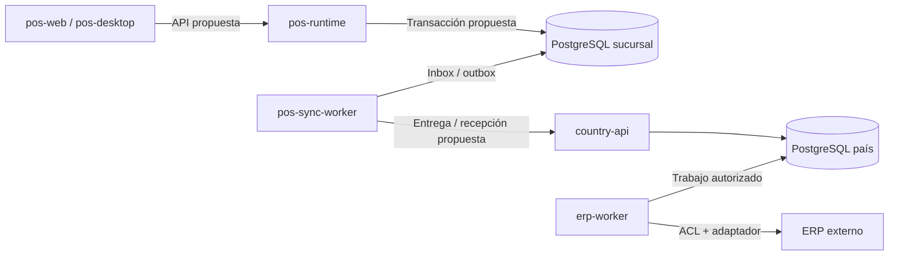

# Monorepo POS Platform

> **Estado de publicación: scaffolding local pendiente de integración.** Esta página documenta la estructura observada en el directorio local el 21 de octubre de 2026. La maqueta web y el contenedor de escritorio están versionados; las aplicaciones backend, sus librerías, dependencias y comandos aún no forman parte del commit que incorpora esta documentación. Las referencias a esa base implementada describen trabajo local en preparación, no capacidades disponibles al clonar esta revisión publicada.

POS Platform es la base de un producto corporativo para varios países. El monorepo reúne clientes web/escritorio, backend de sucursal, backend de país y workers con ciclos de ejecución propios. La demostración funcional actual cubre Chile; la estructura multipaís permite organizar la evolución sin afirmar que las reglas fiscales o integraciones de otros países estén implementadas.

## Estructura

```text
apps/
  pos-web/                 Interfaz Angular; demostración con adaptadores mock
  pos-desktop/             Contenedor Tauri de la misma interfaz
  pos-runtime/             Entrada HTTP del backend de sucursal
  pos-sync-worker/         Proceso de sincronización de sucursal
  country-api/             Entrada HTTP del backend de país
  erp-worker/              Proceso de integración ERP
libs/
  backend/
    sales/                 Ventas y documentos comerciales
    cash/                  Turnos y movimientos de caja
    payments/              Intentos, resultados y conciliación de pagos
    collections/           Cobranza y anticipos
    returns/               Devoluciones y referencias al documento original
    pricing/               Paquetes, evaluación de precios y promociones
    catalog/               Maestros y proyecciones de consulta
    fiscal/                Emisión y estado fiscal por país/proveedor
    devices/               Contratos y coordinación de periféricos
    sync/                  Entrega, recepción y progreso de sincronización
    erp/                   Frontera de integración con cada ERP
    reporting/             Consultas y proyecciones para reportes
    administration/        Configuración, módulos y ámbito organizacional
  contracts/               Contratos intercambiados entre aplicaciones
  shared-kernel/           Primitivas puras comunes al producto
  country-policies/        Perfiles y contratos de política por país
  platform/backend/        Composición técnica reutilizada por las apps Node
  domain/                  Reglas puras del prototipo frontend actual
  data-access/             Adaptadores y estado mock del frontend
  ui/                      Preset y componentes de presentación
  features/                Acceso, checkout, insights y administración de la UI
```

Las librerías se consumen por su entrada pública `@pos-platform/<nombre>`; las pantallas usan `@pos-platform/features/<nombre>` para distinguirlas de contextos del backend como `administration`. El grafo Nx y las reglas de importación expresan sus fronteras; una carpeta no equivale a un servicio desplegado. La estructura conserva las librerías del frontend existentes para migrar recorridos progresivamente, sin llevar `PosStore`, Angular o `localStorage` al backend.

## Aplicaciones y ubicación propuesta

| Aplicación        | Responsabilidad prevista                                                                | Límite actual                                                             |
| ----------------- | --------------------------------------------------------------------------------------- | ------------------------------------------------------------------------- |
| `pos-web`         | Experiencia de caja y administración según permisos                                     | Recorridos conectados con datos sintéticos; usa adaptadores mock          |
| `pos-desktop`     | Alojar la interfaz y futuras capacidades nativas delimitadas                            | Contenedor Tauri; no opera pagos, impresión física ni dispositivos reales |
| `pos-runtime`     | API y composición de módulos transaccionales de sucursal                                | Base HTTP ejecutable; no persiste operaciones de negocio                  |
| `pos-sync-worker` | Programar y ejecutar transferencia y conciliación de datos de sucursal                  | Esqueleto de proceso; no consume colas ni ejecuta sincronizaciones reales |
| `country-api`     | Recibir operaciones y servir capacidades corporativas delimitadas por país              | Base de aplicación; no consolida ventas ni administra países reales       |
| `erp-worker`      | Ejecutar adaptadores en la red autorizada del ERP y conservar resultados de integración | Esqueleto de proceso; no se conecta a AX ni a otro ERP                    |

Los workers tienen ciclo de vida propio. No se añade un listener HTTP de negocio solo para ejecutar tareas. Un futuro backoffice separado o un worker adicional de país requiere una necesidad concreta; no forma parte de estas seis aplicaciones.

## Comandos del workspace

| Comando                   | Alcance                                                                          |
| ------------------------- | -------------------------------------------------------------------------------- |
| `npm start`               | Frontend en `http://127.0.0.1:4300`                                              |
| `npm run api:dev`         | API de sucursal en `http://127.0.0.1:3000`                                       |
| `npm run country:dev`     | API de país en `http://127.0.0.1:3001`                                           |
| `npm run sync:check`      | Compone y cierra el contexto del worker de sincronización; no ejecuta jobs       |
| `npm run erp:check`       | Compone y cierra el contexto del worker ERP; no envía operaciones                |
| `npm run backend:check`   | Lint, tipos, pruebas y build de proyectos backend y librerías puras del producto |
| `npm run backend:build`   | Genera los artefactos de las cuatro aplicaciones backend                         |
| `npm run backend:smoke`   | Verifica los cuatro artefactos fuera del monorepo con dependencias de producción |
| `npm run structure:check` | Comprueba las reglas arquitectónicas del scaffold                                |
| `npm run graph`           | Muestra el grafo de proyectos Nx                                                 |

Los comandos `api:*` se conservan para trabajar únicamente con `pos-runtime`. Los checks de workers comprueban composición y cierre; no equivalen a tener un consumidor, calendario o cola funcionando.

## Propiedad de datos por contexto

Esta tabla fija la responsabilidad propuesta para implementar los módulos. No describe tablas o repositorios ya creados. La misma librería puede aportar contratos y casos de uso a más de una aplicación, pero una operación conserva una autoridad de escritura definida.

| Contexto         | Datos y decisiones bajo su responsabilidad                                                     | Frontera que debe conservar                                                                                |
| ---------------- | ---------------------------------------------------------------------------------------------- | ---------------------------------------------------------------------------------------------------------- |
| `sales`          | Venta, líneas, importes y referencias comerciales; versión de precios aplicada                 | El escritor de sucursal confirma la operación; la copia de país no reescribe su historia                   |
| `cash`           | Turno, fondo, movimientos, arqueo, custodia y cierre                                           | Solo el módulo modifica el libro de caja; pagos y ventas aportan hechos mediante contratos                 |
| `payments`       | Intento de pago, referencia externa, resultado confirmado/rechazado/desconocido y conciliación | Un timeout no autoriza un segundo cobro; la evidencia bancaria sigue perteneciendo al proveedor            |
| `collections`    | Aplicaciones de cobros y anticipos, referencias a deuda y reservas autorizadas                 | Leer un saldo no concede exclusividad para consumirlo; se debe acordar la autoridad de reserva             |
| `returns`        | Cantidades devueltas y vínculo con las líneas e importes originales                            | Devolución comercial, documento fiscal y devolución de dinero son operaciones diferentes                   |
| `pricing`        | Espejo versionado, vigencias, reglas, conjunto activo y resultado explicable                   | La sucursal evalúa datos autorizados; no pasa a ser autora del precio corporativo                          |
| `catalog`        | Proyecciones de productos, clientes y maestros necesarios para operar                          | Cada dato conserva su dueño; el stock consultivo de Chile no se modifica al vender                         |
| `fiscal`         | Solicitudes de emisión, referencias y estados del proveedor fiscal                             | El estado local y la impresión no acreditan aceptación fiscal; homologación por país                       |
| `devices`        | Configuración y estado de comandos de periféricos a través de puertos                          | SDK, drivers y capacidades nativas quedan en adaptadores; entregar al spooler no prueba impresión física   |
| `sync`           | Inbox/outbox, cursor, intento, entrega, programación y acuses                                  | Los productores insertan outbox en la transacción de negocio; el worker no escribe tablas ajenas           |
| `erp`            | Traducciones, referencias externas, entrega y resultado del ERP                                | DTO y estados externos quedan detrás de ACL/adaptadores; un acuse de transporte no equivale a registro ERP |
| `reporting`      | Proyecciones y consultas para indicadores, reportes y exportaciones                            | No modifica operaciones de origen; distingue información incompleta o pendiente                            |
| `administration` | Ámbito empresa/país/sucursal/caja, módulos, políticas y asignaciones                           | Identidad y autorización necesitan integración real; configuración no reemplaza controles de servidor      |

PostgreSQL de sucursal es la persistencia recomendada para negocio y mensajes durables del perfil sin WAN. PostgreSQL operativo por país mantiene sus propias recepciones y proyecciones. Los clientes no acceden a SQL directamente. Esos motores y migraciones están pendientes; no se instala una base por caja como consecuencia de crear el monorepo.



El diagrama muestra la topología objetivo. En esta entrega no existen las conexiones entre aplicaciones, bases y proveedores. El frontend sigue usando el mock. La continuidad ante caída de WAN depende de la LAN y del servidor de sucursal; autonomía ante caída de ambos sería un perfil adicional con decisiones propias.

## Capas y reutilización

Los contextos se crean como un esqueleto explícito para dar ubicación y propietario al trabajo. Sus módulos y contratos iniciales no constituyen una implementación de negocio. No se añaden fachadas que devuelvan éxitos ficticios, repositorios vacíos presentados como persistencia ni endpoints de mutación sin casos de uso.

Cuando se implemente una capacidad, la organización interna sigue su complejidad:

- `api`: controladores, DTO y validación del contrato de entrada.
- `application`: casos de uso, coordinación y puertos requeridos.
- `domain`: reglas e invariantes puras cuando exista dominio que lo justifique.
- `infrastructure`: adaptadores de datos, proveedores o dispositivos.
- `config`: composición y configuración específica del contexto.

Un módulo de consulta simple no necesita fabricar entidades o cinco proyectos Nx separados. Los contextos se comunican por fachadas o interfaces públicas cuando esa interacción exista; no importan repositorios ni modelos privados de otro contexto. `shared-kernel` contiene únicamente conceptos estables compartidos; `contracts` describe intercambios versionados, y `country-policies` concentra variaciones nacionales explícitas. Ninguna de esas tres librerías puras depende de Nest o Angular.

La reutilización técnica sí es actual: las aplicaciones Node comparten configuración, HTTP, errores, logging y ciclo de vida mediante `platform/backend`. La app compone sus módulos y selecciona su identidad; la plataforma no conoce reglas comerciales de los contextos.

El logging permanece en Pino mediante `nestjs-pino`. El reporte opcional con Sentry también pertenece a esta frontera técnica y usa un cliente privado por aplicación: DSN vacío y deshabilitado por defecto, sin instrumentación global, captura automática de solicitudes o trazas distribuidas. Los contextos no deben importar el SDK ni duplicar capturas que ya resuelve la frontera HTTP o de proceso. El [contrato de observabilidad](api.md#reporte-opcional-de-errores-con-sentry) describe datos permitidos, exclusiones, cierre y límites de entrega; estas capacidades no reemplazan identidad, persistencia ni auditoría de negocio.

## Compilación y distribución

### Reglas de código y fronteras

ESLint tiene alcances explícitos; una comprobación sintáctica no se presenta como análisis de tipos de todo el frontend.

| Alcance                                                                                                      | Controles                                                                                                                                                                      |
| ------------------------------------------------------------------------------------------------------------ | ------------------------------------------------------------------------------------------------------------------------------------------------------------------------------ |
| Aplicaciones y librerías TypeScript                                                                          | Sin `any` explícito, `console`, `debugger`, evaluación dinámica ni supresiones de tipos sin justificar; imports y variables comprobados                                        |
| Cuatro apps Node, `libs/backend`, `libs/platform/backend`, `contracts`, `shared-kernel` y `country-policies` | Lint con tipos mediante `tsconfig.eslint.backend.json`, incluyendo sus tests y configuración: promesas, uso inseguro de valores, manejo de errores y exhaustividad de `switch` |
| Aplicaciones y contextos backend                                                                             | Configuración de entorno en la frontera de arranque/configuración; logging por inyección de `nestjs-pino`; sin SDK Sentry ni creación de loggers propios                       |
| Interfaz Angular                                                                                             | Contratos visuales y reglas Angular existentes, junto con las reglas sintácticas comunes; el análisis tipado anterior no cubre el frontend                                     |

Las promesas deben esperarse o manejarse explícitamente: escribir `void` no desactiva la regla. Los tests no deben quedar enfocados u omitidos mediante `only`/`skip`. En backend y librerías puras, `noInlineConfig` impide desactivar reglas con comentarios en el código; las excepciones deben definirse en la configuración central, con alcance preciso y revisión. En el resto del TypeScript, una supresión necesita regla y motivo, y falla si deja de ser necesaria. `@ts-ignore` y `@ts-nocheck` están prohibidos; `@ts-expect-error` exige una descripción de al menos diez caracteres. El bootstrap Angular conserva una excepción acotada para informar un fallo anterior a la inyección mediante `console.error`.

`@nx/enforce-module-boundaries` separa navegador, servidor y librerías puras; también impide que los contextos backend importen otros contextos o que la plataforma técnica dependa de negocio. La app compone módulos. Introducir una futura colaboración requiere definir su contrato y dirección de dependencia; no se habilitan imports internos ni se desactiva el límite por conveniencia. Las pruebas de arquitectura ejercitan la configuración real de ESLint y el grafo Nx.

`npm run lint` comprueba aplicaciones y librerías; `npm run backend:check` incluye los targets de lint del backend. El análisis estático no prueba autorización, atomicidad, privacidad de cualquier texto arbitrario ni corrección comercial; esas garantías requieren contratos y pruebas del comportamiento implementado.

### Artefactos

Las aplicaciones backend consumen librerías fuente del workspace. Rspack y el plugin oficial de Nx empaquetan ese código con SWC y metadata de decoradores; Nest/Fastify y las demás dependencias de runtime se instalan desde el manifiesto y lockfile del artefacto. TSC conserva la comprobación de tipos y Vitest/SWC ejecuta las pruebas. No se publican todas las librerías como paquetes npm solo para desplegar una aplicación.

La decisión adapta el modelo de Core a varias aplicaciones y librerías compartidas: el anterior build TSC de una sola app no empaquetaba aliases de librerías fuente para Node. No se copian plugins de parcheo de Core ni su listado de dependencias cloud. Cada artefacto debe poder instalarse y arrancar desde fuera del monorepo; resolver dependencias accidentalmente desde el `node_modules` raíz no es una validación de distribución.

El build Angular y `vercel.json` mantienen su salida estática. Publicar el frontend en Vercel no publica los servicios Node ni instala los workers de sucursal.

## Evidencia que orienta los límites

Core se inspeccionó en el commit `531f9aa80bc0f9b60ca29bfa38e6694453af99ba`. Las evidencias del legado provienen del [inventario de repositorios](analisis-repositorios/README.md) de la propuesta. Es un análisis de código; no certifica qué artefactos están desplegados. Los enlaces de los repositorios corporativos requieren sus permisos habituales y no incluyen valores de configuración sensibles.

| Fuente y snapshot                                              | Rutas de evidencia                                                                                                                                                                                                                                                                                                                                                                                                                                                       | Decisión que informa                                                                                                                                  |
| -------------------------------------------------------------- | ------------------------------------------------------------------------------------------------------------------------------------------------------------------------------------------------------------------------------------------------------------------------------------------------------------------------------------------------------------------------------------------------------------------------------------------------------------------------ | ----------------------------------------------------------------------------------------------------------------------------------------------------- |
| Core · `531f9aa80bc0f9b60ca29bfa38e6694453af99ba`              | [`apps/core-api/src/bootstrap`](https://github.com/developer-implementos/core/tree/531f9aa80bc0f9b60ca29bfa38e6694453af99ba/apps/core-api/src/bootstrap), [`apps/core-api/rspack.config.js`](https://github.com/developer-implementos/core/blob/531f9aa80bc0f9b60ca29bfa38e6694453af99ba/apps/core-api/rspack.config.js), [`libs/ecommerce-payment`](https://github.com/developer-implementos/core/tree/531f9aa80bc0f9b60ca29bfa38e6694453af99ba/libs/ecommerce-payment) | Apps que componen módulos, librerías por contexto y empaquetado de código interno; convenciones de API detalladas en [api.md](api.md#referencia-core) |
| Mountain · `711f97fd7948c696bf45c992c5b121683bdbacd7`          | [`backend/app/Controllers/Http/PuntoDeVentaController.js`](https://github.com/developer-implementos/mountain-implementos/blob/711f97fd7948c696bf45c992c5b121683bdbacd7/backend/app/Controllers/Http/PuntoDeVentaController.js#L152-L233), [`backend/app/Services/ProductosService.js`](https://github.com/developer-implementos/mountain-implementos/blob/711f97fd7948c696bf45c992c5b121683bdbacd7/backend/app/Services/ProductosService.js#L134-L205)                   | Conservar transacción comercial y separar fiscalidad; sustituir dependencia online del cálculo de precio mediante una capacidad local validada        |
| Sincronizador · `540ab9a70e7befbca27a2f7eb88b87b25109e4d1`     | [`app/Services/ColaMensajeService.js`](https://github.com/developer-implementos/mountain-sync-sucursal/blob/540ab9a70e7befbca27a2f7eb88b87b25109e4d1/app/Services/ColaMensajeService.js#L17-L199), [`app/Services/MensajeDetalleService.js`](https://github.com/developer-implementos/mountain-sync-sucursal/blob/540ab9a70e7befbca27a2f7eb88b87b25109e4d1/app/Services/MensajeDetalleService.js#L79-L780)                                                               | Separar entrega, aplicación y confirmación, con recuperación durable y autoridad de cada módulo                                                       |
| APIs corporativas · `8fbe2f1b4d4e464a403aa3daca63ffe712a9dd70` | [`apiMountainPosCaja/Controllers/CajaController.cs`](https://github.com/developer-implementos/apis-implementos/blob/8fbe2f1b4d4e464a403aa3daca63ffe712a9dd70/apiMountainPosCaja/Controllers/CajaController.cs#L164-L304), [`ServiciosAX/mountainPosCajaServices/RespuestaAx.cs`](https://github.com/developer-implementos/apis-implementos/blob/8fbe2f1b4d4e464a403aa3daca63ffe712a9dd70/ServiciosAX/mountainPosCajaServices/RespuestaAx.cs#L9-L50)                      | Mantener traducción semántica de resultados ERP en `erp`, sin exponer `RecId` o resultados por tabla como estados propios del POS                     |

La evaluación de [pagos y notas de crédito](analisis-repositorios/api-pagos-caja.md), snapshot `33cd625f029aa78798f0baf307c41e17ebee92e1`, y la de [impresión/MICR](analisis-repositorios/api-impresion-caja.md), snapshot `2e74b2d64985902f5fdfb52902016a5f65d7b577`, completan los límites de `payments`, `collections`, `returns` y `devices`. La API histórica de pagos es agregadora de datos/estados de NC, no autorización bancaria; el spooler de Windows tampoco acredita la impresión física.

En esta revisión también se contrastó el checkout `desarrollo` del sincronizador (`97e6d59bfe5e529c941baafa351507a93715d712`) con el informe de `master` citado arriba. Para delimitar la recepción de país se revisó el concentrador (`b2fd1ec266d131abb54b7076d41acce30f045119`), especialmente [`api-lectura/app/Controllers/Http/MensajeSalidasController.js`](https://github.com/developer-implementos/mountain-concentrador/blob/b2fd1ec266d131abb54b7076d41acce30f045119/api-lectura/app/Controllers/Http/MensajeSalidasController.js): sus estados de recibido/procesado justifican separar el acuse durable del resultado ERP. Ninguno de estos snapshots acredita la versión desplegada.

## Estado y siguientes incrementos

| Estado       | Alcance                                                                                                                                                    |
| ------------ | ---------------------------------------------------------------------------------------------------------------------------------------------------------- |
| Implementado | UI mock de Chile, contenedor Tauri, base técnica Nest/Fastify, configuración validada, logging y errores comunes, pruebas y empaquetado                    |
| Scaffold     | Aplicaciones y librerías por responsabilidad, puntos de composición, contratos y perfiles iniciales sin operación comercial real                           |
| Pendiente    | Identidad y permisos de servidor, PostgreSQL/migraciones, transacciones, reglas completas de país, protocolos, jobs durables, integraciones y homologación |

La migración avanza por recorridos comprobables:

1. Acordar contrato, propietario de datos y criterios de aceptación de una capacidad; contrastar casos de Chile con el legado sin ejecutar efectos externos duplicados.
2. Implementar identidad/ámbito y persistencia de sucursal con migraciones y recuperación; probar una transacción de negocio y su outbox en la misma conexión.
3. Reemplazar un adaptador mock del frontend por la API autorizada, manteniendo los demás recorridos explícitamente mock hasta completar sus contratos.
4. Implementar precio local reproducible: paquetes versionados, eventos incrementales, carga masiva programada, ejecución manual controlada y activación atómica.
5. Conectar recepción de país y ERP con inbox/efecto atómicos, deduplicación, acuses precisos y conciliación; verificar reinicios, duplicados, backlog y respuestas inciertas.
6. Homologar un segundo perfil nacional mediante políticas/adaptadores y pruebas de compatibilidad, sin duplicar el producto. Habilitar cada capacidad mediante criterios de piloto y operación acordados.

La ordenación no obliga a completar un módulo entero antes de probar una capacidad; cada incremento debe atravesar contrato, caso de uso, persistencia, interfaz y recuperación cuando correspondan.

## Nombre y compatibilidad

El nombre del producto y del repositorio es **POS Platform**; el paquete raíz y los aliases usan `pos-platform` y `@pos-platform/*`. Para un clon nuevo se recomienda la carpeta `pos-platform`:

```sh
git clone https://github.com/floxcristian/pos-platform.git pos-platform
```

El checkout existente puede conservar el nombre físico `corporate-pos`: no se mueve durante esta modificación para mantener referencias del workspace y procesos locales. Su nombre no altera los targets Nx ni el artefacto.

Las claves `corporate-pos:demo:v1` y `corporate-pos:auth:v1` se conservan para leer datos y sesiones de demostración existentes. También se mantiene el identificador Tauri `com.floxcristian.corporatepos`, que participa en la identidad instalada y el directorio de datos del WebView. Cambiar esas identidades requeriría una migración específica. Los nombres de artefactos y enlaces de revisiones históricas se conservan como evidencia de aquellas entregas.

El nombre visible del producto y el identificador instalado tienen responsabilidades distintas. La continuidad de una actualización sobre el instalador histórico debe comprobarse en Windows; preservar el identificador no prueba por sí solo esa actualización.
